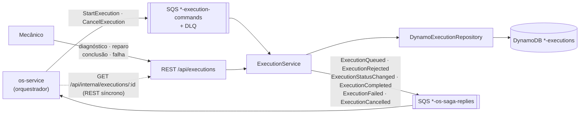

# Execution & Production Service (Fase 4)

Microsserviço de **Execução e Produção** da oficina mecânica (Tech Challenge SOAT/FIAP):
fila de execução das OS, diagnóstico e reparo. **Participante da saga orquestrada** pelo
[os-service](https://github.com/arodri19/soat-fiap-oficina-mecanica-os-service) — arquitetura
geral e justificativa da saga em
[os-service/docs/arquitetura.md](https://github.com/arodri19/soat-fiap-oficina-mecanica-os-service/blob/fase04/docs/arquitetura.md).

## Responsabilidades

- **Gerenciar a fila de execução** das OS pagas (FIFO, com limite de capacidade da oficina)
- **Atualizar o status durante diagnóstico e reparo** (ações do mecânico)
- **Comunicar a finalização ao OS Service** (`ExecutionCompleted`) — ou a falha (`ExecutionFailed`),
  que dispara o estorno do pagamento na saga
- Compensação: `CancelExecution`

## Arquitetura



```
QUEUED ──► DIAGNOSING ──► REPAIRING ──► COMPLETED
   │            │              │
   └────────────┴──────────────┴──► FAILED (mecânico) | CANCELLED (compensação)
```

- **Capacidade**: `StartExecution` é recusado (`ExecutionRejected`) quando a oficina já tem
  `MAX_ACTIVE_EXECUTIONS` OS na fila/em andamento — a saga então estorna o pagamento.
- **Outbox no próprio item**: cada ação do mecânico grava o novo status **e** o evento para a
  saga na mesma escrita (atômica) do DynamoDB; o evento é publicado em seguida e, se o SQS
  falhar, é republicado pelo job periódico (índice esparso `gsi2`). A OS nunca fica finalizada
  aqui sem o os-service saber.
- Comandos reentregues pelo SQS respondem o mesmo resultado (criação condicional por OS).

### Banco: DynamoDB (NoSQL)

| Chave | Uso |
|---|---|
| `pk = EXECUTION#<orderId>` | um documento por OS, com a linha do tempo (quem, quando, notas) aninhada |
| `gsi1`: `STATUS#<status>` / `queuedAt` | fila por status em ordem de chegada |
| `gsi2`: `OUTBOX` / `updatedAt` (esparso) | só itens com evento pendente de publicação |

## API (Swagger em `/api-docs`)

| Método | Rota | Descrição |
|---|---|---|
| GET | `/api/executions/queue` | fila (posição, OS, veículo, serviços, estimativa) |
| GET | `/api/executions?status=` | execuções por status |
| GET | `/api/executions/:orderId` | execução + linha do tempo |
| POST | `/api/executions/:orderId/diagnosis/start` | `{ mechanicName }` → OS EM_DIAGNOSTICO |
| POST | `/api/executions/:orderId/repair/start` | `{ diagnosisNotes }` → OS EM_EXECUCAO |
| POST | `/api/executions/:orderId/complete` | `{ notes }` → OS FINALIZADA (saga concluída) |
| POST | `/api/executions/:orderId/fail` | `{ reason }` → compensação (estorno) |
| GET | `/api/internal/executions/:orderId` | REST síncrono para o os-service (JWT `SERVICE`) |

## Executando

```bash
npm install
docker compose up --build    # LocalStack (SQS + DynamoDB) + exec-prod isolado
```

Fluxo completo com os três serviços: `docker compose up --build` no repositório do os-service.

## Testes e qualidade

- **Unitários**: domínio (transições, outbox), ExecutionService (capacidade, idempotência,
  outbox com SQS fora do ar, compensação), DynamoDB, rotas, mensageria.
- **BDD**: [`tests/bdd/features/fila-execucao.feature`](tests/bdd/features/fila-execucao.feature)
  — fluxo diagnóstico → reparo → finalização, oficina lotada, cancelamento, falha no reparo.

### Evidência de cobertura (mínimo 80% — o CI falha abaixo disso)

```
Statements   : 98.99% ( 393/397 )
Branches     : 95.26% ( 161/169 )
Functions    : 99.05% ( 105/106 )
Lines        : 99.44% ( 356/358 )
Test Suites: 6 passed · Tests: 54 passed
```

## CI/CD e infraestrutura

- [`ci.yml`](.github/workflows/ci.yml): testes + cobertura ≥ 80% + **SonarQube Quality Gate** + build da imagem
- [`cd.yml`](.github/workflows/cd.yml): a cada merge em `homologacao`/`main` → CI → imagem no Docker Hub →
  Terraform (tabela DynamoDB, fila `*-execution-commands` + DLQ, IAM) → deploy no EKS + smoke test
  (pulado com aviso se o cluster estiver desligado)
- [`k8s/`](k8s): ConfigMap (`MAX_ACTIVE_EXECUTIONS`), Deployment, Services, HPA
- Branches `main`/`homologacao` protegidas; desenvolvimento na `fase04`

## Observabilidade

New Relic APM (`oficina-exec-prod-service`), distributed tracing pelos envelopes SQS e evento
`ExecutionStatusChanged` (painel "Fila de execução" do dashboard).
